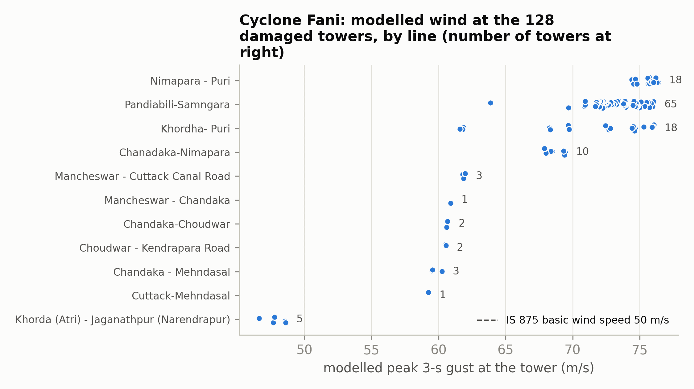
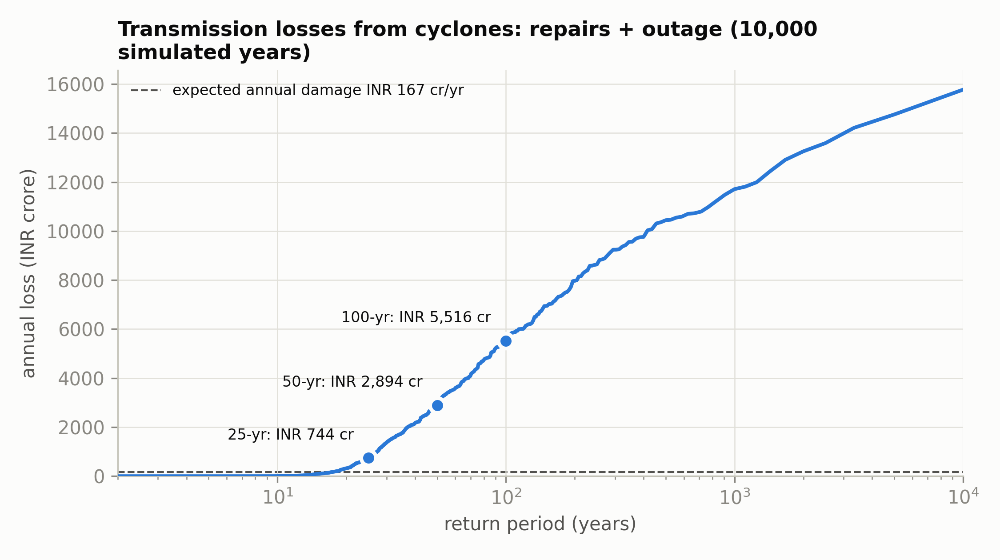
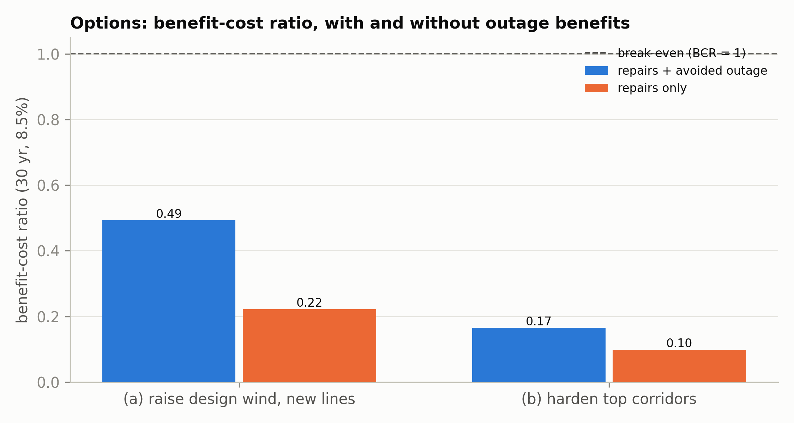

# Cyclone risk to Odisha's transmission towers and a design-standard review

An open, reproducible assessment of cyclone wind risk to the Odisha (India) power transmission network, built entirely with free and open-source tools (Google Colab, Python, QGIS, Google Earth Engine, LibreOffice / Google Sheets).

The work links to CDRI's Odisha power-sector resilience programme, design-standard reform (IS 875 / IS 802), and probabilistic planning for infrastructure resilience (Sendai Framework Target D, SDG 9.1).

| Workstream | What it covers | Notebook |
|---|---|---|
| 1A | Concept note and literature review | `docs/` (to be added) |
| 1B | Cyclone Fani (2019) case study: wind at the 128 damaged towers, fragility fit | `02_fani_case_study.ipynb` |
| 1C | IS 875 / IS 802 code-gap map with WMO wind-averaging conversion | `04_code_gap.ipynb` |
| 1D | Holland wind field, Monte Carlo over 10,000 years of STORM cyclones, fragility, expected annual damage and 25/50/100-year losses | `03_hazard_storm.ipynb`, `05_risk_losses.ipynb` |
| 1E | Options (raise design wind on new lines, harden riskiest corridors, do nothing): 30-year cost-benefit with sensitivity | `06_options_cba.ipynb` |
| 1F | Briefing-note figures and key numbers | `07_brief_figures.ipynb` |

---

## Key findings

**Cyclone Fani (1B)**
- 128 transmission towers damaged (87 collapsed); 87% on four 132/220 kV lines near Puri (Pandiabili–Samangara, Khordha–Puri, Nimapara–Puri, Chandaka–Nimapara).
- Median modelled 3-s gust at damaged towers: **72.9 m/s (262 km/h)**. 96% exceeded the IS 875 basic wind speed (50 m/s); 84% exceeded OPTCL's IS 802:1995 design wind (39.3 m/s, 10-min mean).
- Fani was roughly a **1-in-80-year** wind at the damaged towers (STORM); the lines are designed for 1-in-50.
- Fragility fitted on Fani (any damage): median **81.9 m/s**, β 0.14; collapse: 86.1 m/s, β 0.15. Agrees with Raj et al. (81.2 m/s, β 0.10).

**Design-code gap (1C)**
- At 50 years the OPTCL design wind is not exceeded (50-yr STORM wind 34–38 m/s vs 39.3 m/s; thinnest margin on the Puri–Jagatsinghpur–Kendrapara coast).
- **Cyclone wind grows much faster with return period than the code assumes**: at Puri the 150-yr and 500-yr winds are +42% and +77% above the 50-yr value, while IS 802's reliability levels add only +13% and +28%. The hazard exceeds reliability level 2 at 96% of study towers and level 3 at 100%.
- The **gust factor** matters as much as the wind map: IS 802 converts gust to 10-min mean with 1.375 (≈ WMO off-sea), while the WMO cyclone factor inland is 1.66. A 21% difference in gust factor means a 46% difference in wind load.

**Risk (1D)**
- Expected annual damage ≈ **INR 140–190 crore/yr** (base 168: repairs 68, outage 100). Outage dominates.
- Losses: 25-yr ≈ INR 700–1,600 crore; 50-yr ≈ 2,650–3,550 crore; 100-yr ≈ 4,100–5,600 crore.
- Highest-risk towers: Puri and Jagatsinghpur, mostly 132 kV, within 20 km of the coast.
- **Limitation:** tower-damage counts are over-predicted for other cyclones (Phailin, 1999); no single fragility fits all events with this wind model. Tower counts are reported as a range; wind-field uncertainty is the main uncertainty.

**Options (1E), 30 years at 8.5%**

| Option | Benefit-cost ratio | BCR, repairs only | NPV (INR crore) |
|---|---|---|---|
| (a) Raise design wind on new coastal lines | 0.49 | 0.22 | −190 |
| (b) Harden the 10 riskiest lines | 0.17 | 0.10 | −893 |
| (c) Do nothing | baseline | | |

- Option (a) breaks even if the higher design adds ≤ ~10% to new-tower cost, or if the value of lost load is ≥ ~INR 290/kWh.
- Retrofitting does not pay on avoided repairs alone, even tower-by-tower: no tower exceeds a 1% annual damage probability.
- **Implication:** build higher design winds into the code for new coastal lines; retrofit existing lines only where outages are very costly (critical loads), chosen by criticality, not hazard alone.





All numbers: `outputs/tables/07_key_numbers.csv` (each with its source notebook).

---

## Repository structure

```
notebooks/        8 Colab notebooks, run in order 00 → 07
src/cdri_lib.py   shared functions (wind field, gust conversion, fragility, risk engine); also embedded in each notebook
outputs/figures/  all figures
outputs/tables/   all result tables, incl. 06_cba_model.xlsx (live-formula cost-benefit workbook)
outputs/results/  fragility parameters and risk summary (JSON)
data/README.md    data sources; raw data is downloaded by Notebook 00, not stored here
docs/             concept note, literature review and briefing note (to be added)
```

## How to run

1. Open each notebook in [Google Colab](https://colab.research.google.com) (File → Upload notebook) and run them in order, 00 → 07 (Runtime → Run all).
2. Allow Google Drive access when asked; everything is saved to `MyDrive/CDRI_Odisha/`.
3. Notebook 00 downloads all data (STORM directly from 4TU, or upload the STORM zip to `MyDrive/CDRI_Odisha/data/raw/`).
4. Notebook 01 uses Google Earth Engine (free for non-commercial use; set your project ID in the settings cell). If Earth Engine is unavailable it falls back to a distance-to-coast rule and Raj et al.'s population weights.
5. Settings (costs, value of lost load, discount rate, fragility options) are at the top of each notebook. After changing a setting, re-run that notebook and the ones after it.

Runtime: about 45–90 minutes in total on free Colab. Requirements: `requirements.txt` (Colab already has most).

## Method notes and limitations
- Wind field: Holland (1980) profile with translation asymmetry; no land-roughness reduction of the mean wind (as in STORM); exposure handled by WMO/TD-1555 gust factors.
- In the published run, Earth Engine was not used: exposure was set by distance to coast (≤2 km off-sea, else in-land) and outage population from Raj et al.'s substation weights.
- Hazard: STORM present climate (1980–2017 basis). STORM under-represents cyclone frequency on the southern Odisha coast compared with IBTrACS 1980–2025.
- Fragility calibrated on one event (Fani); transferability to other cyclones is limited (see 1D).
- Today's network (OpenStreetMap-based, via Raj et al.) is used for all historical events.
- IS 875:2015, IS 802:2015 and CEA 2022 values in Notebook 04 are marked `VERIFY` / `TO FILL`.

## Data and credits
See `data/README.md` and `REFERENCES.md`. The transmission network and Fani tower-damage records come from Raj, Kumar & Bhatia (IIT Gandhinagar), [GitHub repository](https://github.com/surendervraj/cyclone-prepardness-for-regional-power-transmission-network); damage records originate from OPTCL (obtained under RTI). Only aggregated damage tables are published here.

## Licence
Code: MIT (see `LICENSE`). Data remain under their original licences.
